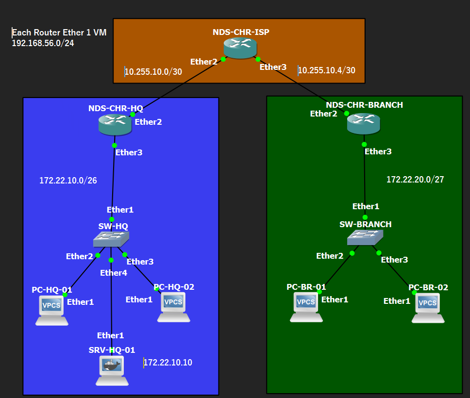

# 🌐 Small Office Multi-Site Network Deployment

### PT Nusa Digital Solusi (NDS) · `NDS-NET-001`

**MikroTik CHR · GNS3 · VirtualBox · Static Routing · Firewall & NAT**

*A two-site office network with centralized HQ services, private ISP transit, and dedicated router management.*

---

## 🧭 Project at a Glance

<table>
<tr>
<td width="50%" valign="top">
<h3>🏢 Business Scenario</h3>

<strong>Headquarters (HQ):</strong> planned capacity for 25 users, DHCP services, and an internal HTTP server.

<strong>Branch Office:</strong> planned capacity for 10 users, local DHCP, and access to HQ resources.

<strong>4 VPCS clients</strong> (2 per office) represent endpoint traffic; they do not simulate all 35 employees.

</td>
<td width="50%" valign="top">
<h3>🎯 Network Objectives</h3>
<ul>
<li>Independent IPv4 LANs with DHCP</li>
<li>Bidirectional HQ ↔ Branch communication</li>
<li>Static routing through a simulated ISP</li>
<li>Centralized Nginx HTTP service at HQ</li>
<li>Stateful firewall, scoped DST-NAT, and traffic validation</li>
</ul>
</td>
</tr>
<tr>
<td width="50%" valign="top">
<h3>🧰 Infrastructure</h3>
<ul>
<li><strong>3</strong> MikroTik CHR routers</li>
<li><strong>2</strong> Ethernet switches</li>
<li><strong>4</strong> VPCS clients</li>
<li><strong>1</strong> Docker Nginx server (HQ only)</li>
</ul>
</td>
<td width="50%" valign="top">
<h3>🛠️ Technology Stack</h3>
<ul>
<li><strong>Network emulator:</strong> GNS3</li>
<li><strong>Virtualization:</strong> Oracle VirtualBox + GNS3 VM</li>
<li><strong>Router OS:</strong> MikroTik RouterOS CHR</li>
<li><strong>Management:</strong> WinBox, RouterOS CLI, SSH</li>
<li><strong>Clients & service:</strong> VPCS, Docker Nginx</li>
</ul>
</td>
</tr>
</table>

## 🗺️ Network Topology

HQ ↔ simulated private ISP ↔ Branch. The HTTP server is deployed only at HQ. Each CHR uses <code>ether1</code> for VirtualBox Host-Only management.

## 🗓️ Project Timeline

| Phase | Deliverable | Status |
|:---:|---|:---:|
| 01 | Network design, subnetting, and IP addressing | ✅ Completed |
| 02 | GNS3 topology, RouterOS CHR deployment, and WAN interfaces | ✅ Completed |
| 03 | LAN DHCP, VPCS clients, and HQ Nginx HTTP service | ✅ Completed |
| 04 | Static routing and inter-site connectivity | ✅ Completed |
| 05 | INPUT/FORWARD firewall, management hardening, DST-NAT, regression | ✅ Completed |
| 06 | End-to-end validation and controlled troubleshooting (3 cases) | ✅ Completed |
| **07** | **Technical documentation, evidence, and portfolio finalization** | **✅ Completed** |

Milestones: design approved 29 Oct 2026; infrastructure and LAN verified 30 Oct 2026; inter-site routing verified by 31 Oct 2026; firewall/NAT regression and all three troubleshooting scenarios completed 1 Nov 2026; final documentation and portfolio assembled 1 Nov 2026.

## 🌐 Network Addressing

<table>
<tr>
<td width="50%" valign="top">
<h3>🔵 Headquarters LAN</h3>

<strong>Subnet:</strong> <code>172.22.10.0/26</code> 
<strong>Gateway:</strong> <code>172.22.10.1</code> 
<strong>DHCP pool:</strong> <code>172.22.10.20–172.22.10.59</code> 
<strong>HTTP server:</strong> <code>172.22.10.10:80</code> 
<strong>Usable hosts:</strong> 62

</td>
<td width="50%" valign="top">
<h3>🟢 Branch LAN</h3>

<strong>Subnet:</strong> <code>172.22.20.0/27</code> 
<strong>Gateway:</strong> <code>172.22.20.1</code> 
<strong>DHCP pool:</strong> <code>172.22.20.10–172.22.20.29</code> 
<strong>HTTP server:</strong> None; uses HQ service 
<strong>Usable hosts:</strong> 30

</td>
</tr>
<tr>
<td width="50%" valign="top">
<h3>🟠 Private WAN Transit</h3>

<strong>HQ ↔ ISP:</strong> <code>10.255.10.0/30</code> 
HQ <code>10.255.10.1</code> · ISP <code>10.255.10.2</code>

<strong>ISP ↔ Branch:</strong> <code>10.255.10.4/30</code> 
ISP <code>10.255.10.5</code> · Branch <code>10.255.10.6</code>

</td>
<td width="50%" valign="top">
<h3>🟣 Management Network</h3>

<strong>VirtualBox Host-Only:</strong> <code>192.168.56.0/24</code>

HQ <code>192.168.56.115</code> 
ISP <code>192.168.56.113</code> 
Branch <code>192.168.56.114</code>

Addresses shown are lab-assigned management IPs; <code>ether1</code> obtains its address dynamically.

</td>
</tr>
</table>

<strong>📋 Router interfaces & static routes</strong>

| Router | Interface | Address | Function |
|---|---|---|---|
| HQ | `ether2` | `10.255.10.1/30` | WAN → ISP |
| HQ | `ether3` | `172.22.10.1/26` | HQ LAN |
| ISP | `ether2` | `10.255.10.2/30` | WAN → HQ |
| ISP | `ether3` | `10.255.10.5/30` | WAN → Branch |
| Branch | `ether2` | `10.255.10.6/30` | WAN → ISP |
| Branch | `ether3` | `172.22.20.1/27` | Branch LAN |

| Router | Destination | Next hop |
|---|---|---|
| HQ | `172.22.20.0/27` | `10.255.10.2` |
| ISP | `172.22.10.0/26` | `10.255.10.1` |
| ISP | `172.22.20.0/27` | `10.255.10.6` |
| Branch | `172.22.10.0/26` | `10.255.10.5` |

## 🛡️ Project Scope

<table>
<tr>
<td width="50%" valign="top">
<h3>✅ In Scope</h3>
<ul>
<li>IPv4 addressing & subnetting</li>
<li>DHCP at HQ and Branch</li>
<li>Static inter-site routing via private ISP transit</li>
<li>Centralized HTTP server at HQ</li>
<li>Stateful INPUT and FORWARD firewalls</li>
<li>WinBox/SSH management restrictions</li>
<li>HQ HTTP destination NAT</li>
<li>Traffic verification and controlled fault diagnosis</li>
</ul>
</td>
<td width="50%" valign="top">
<h3>🚫 Out of Scope</h3>
<ul>
<li>Public Internet access</li>
<li>Site-to-site VPN</li>
<li>VLANs or wireless infrastructure</li>
<li>OSPF/BGP dynamic routing</li>
<li>High availability and redundancy</li>
<li>Dedicated internal server at Branch</li>
<li>Inter-site SRC-NAT / masquerade</li>
</ul>
</td>
</tr>
</table>

## ⚙️ Implemented Network Features

<table>
<tr>
<td width="50%" valign="top">
<h3>🔀 Routing & Services</h3>
<ul>
<li>Static routes between HQ and Branch</li>
<li>Local DHCP services on both office routers</li>
<li>Nginx HTTP server at <code>172.22.10.10</code></li>
<li>Management network separated from office LANs</li>
</ul>
</td>
<td width="50%" valign="top">
<h3>🔒 Firewall & NAT</h3>
<ul>
<li>Stateful INPUT/FORWARD policies on all 3 routers</li>
<li>Explicit ICMP/HTTP allowances and default-drop rules</li>
<li>SSH/WinBox scoped to Host-Only management subnet</li>
<li>HQ DST-NAT: <code>10.255.10.1:80</code> → <code>172.22.10.10:80</code></li>
<li>No inter-site SRC-NAT or masquerade</li>
</ul>
</td>
</tr>
</table>

## ✅ Verified Results

<table>
<tr>
<td width="50%" valign="top">
<h3>📡 LAN & Inter-Site</h3>
<ul>
<li><strong>4/4</strong> VPCS clients received expected DHCP addressing</li>
<li><strong>5/5</strong> ICMP replies HQ → Branch</li>
<li><strong>5/5</strong> ICMP replies Branch → HQ</li>
<li>Both site gateways and connected routes verified</li>
</ul>
</td>
<td width="50%" valign="top">
<h3>🌍 HTTP & NAT</h3>
<ul>
<li><strong>HTTP 200</strong> to HQ Nginx directly</li>
<li><strong>HTTP 200</strong> via HQ WAN port forwarding</li>
<li>DST-NAT connection tracking flag observed</li>
<li>HQ NAT rule packet counter confirmed</li>
</ul>
</td>
</tr>
<tr>
<td width="50%" valign="top">
<h3>🧱 Firewall Enforcement</h3>
<ul>
<li>INPUT and FORWARD default-drop enabled on all routers</li>
<li>Branch negative forwarding test blocked <strong>5/5</strong> ICMP attempts</li>
<li>Drop-rule counter increased by <strong>5 packets</strong></li>
</ul>
</td>
<td width="50%" valign="top">
<h3>🔐 Management Access</h3>
<ul>
<li>SSH login verified on HQ, ISP, and Branch</li>
<li>WinBox used for management over Host-Only network</li>
<li>Management source restriction configured for <code>192.168.56.0/24</code></li>
</ul>
</td>
</tr>
</table>

> **Test coverage:** HTTP requests were generated by the **Branch router** with source `172.22.20.1`. Client-originated HTTP forwarding through the Branch router has not been independently validated with a LAN HTTP client. The deployment includes no additional Branch server.

## 🧪 Troubleshooting Case Reports

Three controlled failures were introduced, investigated, and recovered against the validated network baseline. Each case includes baseline and fault-condition RouterOS exports, a case report, and six screenshots documenting failure, diagnosis, and recovery.

| Scenario | Fault introduced | Recovery verified | Report |
|---|---|---|---|
| **01 · WAN Link Failure** | ISP `ether2` administratively disabled | WAN restored; HQ ↔ Branch ICMP **5/5 each direction** | [View Case 01](troubleshooting/scenario-01-wan-link-failure/) |
| **02 · Firewall Policy Failure** | Incorrect DROP rule ahead of ISP FORWARD allow rules | Fault rule removed; HQ ↔ Branch ICMP **5/5 each direction** | [View Case 02](troubleshooting/scenario-02-firewall-policy-failure/) |
| **03 · Static Route Failure** | ISP route to HQ LAN changed to incorrect next-hop `10.255.10.9` | Next-hop restored; HQ ↔ Branch ICMP **5/5 each direction** | [View Case 03](troubleshooting/scenario-03-static-route-failure/) |

[**Browse all troubleshooting documentation**](troubleshooting/)

## 📦 Project Files & Final Router Configurations

<table>
<tr>
<td width="50%" valign="top">
<h3>🗺️ GNS3 Project</h3>

<a href="assets/Small-Office-Multi-Site-Network-Deployment.gns3"><strong>Download GNS3 topology definition</strong></a>

The <code>.gns3</code> file stores the project topology and node/link definitions. It does <strong>not</strong> include RouterOS CHR virtual disks or a ready-to-run virtual environment.

</td>
<td width="50%" valign="top">
<h3>⚙️ Final RouterOS Exports</h3>
<ul>
<li><a href="configurations/NDS-CHR-HQ-FINAL.rsc">NDS-CHR-HQ-FINAL.rsc</a></li>
<li><a href="configurations/NDS-CHR-ISP-FINAL.rsc">NDS-CHR-ISP-FINAL.rsc</a></li>
<li><a href="configurations/NDS-CHR-BRANCH-FINAL.rsc">NDS-CHR-BRANCH-FINAL.rsc</a></li>
</ul>

Final post-recovery configuration snapshots of the three routers, separate from the fault-state exports in the case studies.

</td>
</tr>
</table>

> **Reproduction requirements:** GNS3, VirtualBox with compatible MikroTik CHR virtual machines, appropriate network adapters/Host-Only management setup, VPCS, and Docker Nginx are required. Review node templates and paths before opening the project. RouterOS <code>.rsc</code> files are configuration exports, not safe incremental patches to import into already configured devices.

## ✅ Project Delivery Summary

<table>
<tr>
<td width="50%" valign="top">
<h3>📡 Network Implementation</h3>
<ul>
<li>HQ and Branch IPv4 LANs with DHCP</li>
<li>Inter-site static routing through private ISP transit</li>
<li>Centralized HQ Nginx HTTP service</li>
<li>Stateful INPUT/FORWARD firewall policies and HQ HTTP DST-NAT</li>
<li>Final configuration exports for all three routers</li>
</ul>
</td>
<td width="50%" valign="top">
<h3>🧪 Validation & Documentation</h3>
<ul>
<li>Connectivity and service verification results</li>
<li><a href="troubleshooting/">Three completed troubleshooting cases</a></li>
<li>Baseline and fault exports, plus six evidence images per case</li>
<li>Project topology diagram and GNS3 definition</li>
<li>Linked technical reports and recovery outcomes</li>
</ul>
</td>
</tr>
</table>

> **Security and scope:** RouterOS binary backups, VM disks, and credentials are not part of this public repository. The ISP is simulated private transit, not public Internet. HTTP validation was performed from the Branch router rather than an HTTP-capable Branch LAN client. The exported files describe a virtual lab, not a production-ready deployment.

---

Network Design v1.0 · Interface Mapping v1.1 · Fictional company / virtual lab · Updated 1 November 2026

