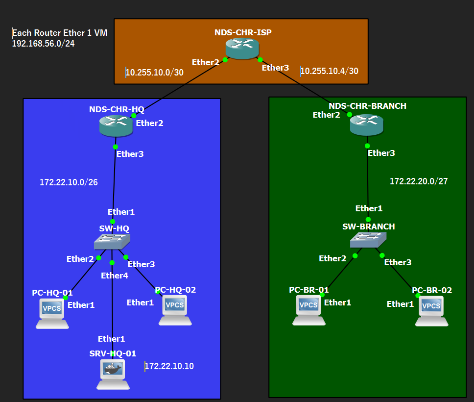

# Small Office Multi-Site Network Deployment

> **MikroTik MTCNA Home Lab — Final Project**  
> **Status:** Phase 01 Completed · Phase 02 In Progress (Topology Deployed; RouterOS Configuration Pending) · **Design baseline:** Network Design v1.0 — Approved (29 October 2026), interface mapping revision v1.1 · **Environment:** GNS3 / MikroTik RouterOS

## Project Overview

This project simulates the design, deployment, validation, and troubleshooting of a small company's network across two offices: **Headquarters (HQ)** and **Branch Office**. It is the capstone project of a MikroTik MTCNA-oriented home lab learning journey and is intended to demonstrate practical **Junior Network Engineer** skills.

The scenario is fictional and runs in a controlled lab environment. The Phase 01 design review has been completed and Network Design v1.0 has been approved. The GNS3 topology has been built with dedicated Final Project CHR nodes and an internal server container. RouterOS interface configuration and end-to-end service validation have not yet been completed; test results will be added only after verification.

## Business Scenario

**PT Nusa Digital Solusi** is a fictional IT services company with two sites:

| Site | Planned users | Key needs |
| --- | ---: | --- |
| Headquarters (HQ) | 25 | Local connectivity, DHCP, internal HTTP server, branch access |
| Branch Office | 10 | Local connectivity, DHCP, access to HQ resources |

The offices communicate through a **simulated ISP transit router**, not a real public Internet connection. This lab does **not** represent secure site-to-site communication over the public Internet; a production deployment would require a separate WAN/security design.

## Project Objectives

- Translate business requirements into a logical network topology and IP addressing plan.
- Configure MikroTik RouterOS interfaces, IP addressing, and DHCP services.
- Establish bidirectional inter-site communication using static routes.
- Apply and verify appropriate firewall rules; use NAT only where a defined requirement calls for it.
- Provide branch access to an internal HTTP service hosted at HQ.
- Validate connectivity, investigate controlled failures, and document the findings.
- Publish reproducible topology, configuration evidence, and test results.

## Scope

**In scope:** Two office LANs, three MikroTik routers (HQ, ISP simulation, Branch), two Ethernet switches, four representative client PCs, one internal HTTP server, IPv4 subnetting, DHCP, static routing, firewall filtering, basic service testing, troubleshooting, and documentation.

**Out of scope:** Production Internet connectivity, VPN, VLAN segmentation, OSPF/BGP, high availability, enterprise authentication, and other advanced features beyond the selected MTCNA-level learning objectives.

> **Capacity note:** The 25 HQ and 10 Branch users are planning assumptions. Only two representative test clients per office will be instantiated in GNS3.

## Network Topology — GNS3 Deployment (Interface Mapping v1.1)

*Figure 1 — GNS3 topology showing Headquarters, Branch Office, simulated ISP transit, two client PCs per office, and the internal HTTP server at HQ. Network labels indicate the approved addressing plan, not yet verified device configuration.*

The network is divided into HQ (`172.22.10.0/26`), Branch (`172.22.20.0/27`), and transit links (`10.255.10.0/30`, `10.255.10.4/30`). Router `ether1` is reserved for the separate VirtualBox Host-Only management network (`192.168.56.0/24`) and is not part of the simulated business traffic paths. The screenshot records physical/logical node placement and cabling only; application services and routed connectivity remain untested.

## Approved IP Addressing Plan — v1.0

The following addressing is the **approved Phase 01 design baseline**. Implementation results will be verified during later phases; any necessary design changes will be documented.

### LANs

| Segment | Network | Gateway | Usable hosts | DHCP allocation |
| --- | --- | --- | ---: | --- |
| HQ LAN | `172.22.10.0/26` | `172.22.10.1` | 62 | `172.22.10.20–172.22.10.59` |
| Branch LAN | `172.22.20.0/27` | `172.22.20.1` | 30 | `172.22.20.10–172.22.20.29` |

The internal web server is planned at **`172.22.10.10` (static)**, outside the HQ DHCP pool.

### WANs and Router Interfaces — Mapping Revision v1.1

| Router | Interface | Connects to | Approved address |
| --- | --- | --- | --- |
| NDS-CHR-HQ | `ether2` | NDS-CHR-ISP `ether2` | `10.255.10.1/30` |
| NDS-CHR-HQ | `ether3` | SW-HQ `ether1` | `172.22.10.1/26` |
| NDS-CHR-ISP | `ether2` | NDS-CHR-HQ `ether2` | `10.255.10.2/30` |
| NDS-CHR-ISP | `ether3` | NDS-CHR-BRANCH `ether2` | `10.255.10.5/30` |
| NDS-CHR-BRANCH | `ether2` | NDS-CHR-ISP `ether3` | `10.255.10.6/30` |
| NDS-CHR-BRANCH | `ether3` | SW-BRANCH `ether1` | `172.22.20.1/27` |

WAN-1: `10.255.10.0/30` · WAN-2: `10.255.10.4/30`.

> **Management plane:** `ether1` on each CHR is reserved for the VirtualBox Host-Only segment `192.168.56.0/24`. The segment is separate from the simulated WAN/LAN, and unique router management addresses must be confirmed before assigning IPs. The Windows host address observed during preparation was `192.168.56.112/24`.

## Approved Static Routing Plan

| Router | Destination | Next hop |
| --- | --- | --- |
| R-HQ | `172.22.20.0/27` | `10.255.10.2` |
| R-ISP | `172.22.10.0/26` | `10.255.10.1` |
| R-ISP | `172.22.20.0/27` | `10.255.10.6` |
| R-BRANCH | `172.22.10.0/26` | `10.255.10.5` |

These are **approved planned routes**, not an exported or verified RouterOS configuration. NAT is not required for inter-site communication through this controlled routed transit network; firewall policy must permit the required traffic.

## Devices and Tools

| Item | Quantity | Purpose |
| --- | ---: | --- |
| MikroTik CHR / RouterOS | 3 | HQ, simulated ISP, Branch routing |
| Ethernet switches | 2 | LAN connectivity |
| VPCS clients | 4 | Representative endpoints and DHCP tests |
| Linux VM/container | 1 | Internal HTTP server |
| GNS3 | — | Network emulation |
| WinBox / RouterOS CLI | — | Configuration and verification |

**Total GNS3 network nodes: 10.** Three dedicated Final Project CHR nodes, two switches, four VPCS clients and one Docker server node are placed and linked. GNS3 VM was observed running server version 2.2.61; exact RouterOS versions remain to be recorded.

## Project Phases

| Phase | Description | Status |
| --- | --- | --- |
| 01 | Business requirements, topology, addressing, design review | **Completed — Design v1.0 Approved** |
| 02 | GNS3 topology deployment, RouterOS foundation and interface addressing | **In progress — topology deployed; RouterOS configuration pending** |
| 03 | LAN and DHCP deployment | Not started |
| 04 | Static routing integration | Not started |
| 05 | Firewall and NAT requirement review | Not started |
| 06 | Validation and controlled troubleshooting | Not started |
| 07 | Final evidence, documentation, and assessment | Not started |

## Planned Acceptance Tests

| ID | Verification | Expected outcome | Actual |
| --- | --- | --- | --- |
| T-01 | HQ client DHCP | Receives HQ address, mask and gateway | Not tested |
| T-02 | Branch client DHCP | Receives Branch address, mask and gateway | Not tested |
| T-03 | HQ client → HQ gateway | Reachable | Not tested |
| T-04 | Branch client → Branch gateway | Reachable | Not tested |
| T-05 | HQ client → Branch client | Reachable | Not tested |
| T-06 | Branch client → HQ client | Reachable | Not tested |
| T-07 | Branch client → HQ HTTP server | HTTP response received | Not tested |
| T-08 | Firewall policy checks | Traffic handled as designed | Not tested |
| T-09 | Simulated fault investigation | Root cause and fix documented | Not tested |

Evidence (screenshots, command outputs, and troubleshooting notes) will be linked once available.

## Deliverables

- GNS3 project topology and finalized addressing table.
- Device configuration backups/exports **sanitized to remove credentials and secrets**.
- DHCP, route, and firewall verification outputs.
- End-to-end testing evidence, including HTTP service access.
- Troubleshooting case notes: symptoms, hypothesis, checks, root cause, fix, and retest.
- Final design decisions, limitations, and lessons learned.

## Learning and Review Method

The project uses a **KILLCRITIC mentoring workflow**: theory → design reasoning → implementation → verification → troubleshooting → assessment. Progression requires explaining *why* a change is needed and demonstrating the expected result—not merely copying commands or obtaining a successful ping.

## Design Approval Record

| Item | Value |
| --- | --- |
| Design reference | `NDS-NET-001` |
| Baseline | Network Design v1.0 |
| Approval date | 29 October 2026 |
| Approval scope | Business requirements, logical topology, IP plan, original interface mapping, routing plan, acceptance criteria |
| Mapping amendment | v1.1 — ether1 reserved for Host-Only management; project WAN/LAN links moved to ether2/ether3 |
| Implementation status | Not started |

## Current Progress

**Phase 01: Completed (29 October 2026).** Design B (two offices with an internal server at HQ) has passed the KILLCRITIC design review. Business requirements, logical topology, IP addressing, interface mapping, and planned static routes are **approved as Network Design v1.0**.

**Phase 02: In progress.** Dedicated Final Project CHR nodes, switches, clients, and the Docker server node have been placed and cabled in GNS3; the updated topology is recorded above. GNS3 VM connectivity was restored and Docker node creation succeeded, but the initial root cause of the earlier compute-server error was not confirmed. Next: verify router instance isolation and management/interface mapping, then proceed with RouterOS foundation and addressing. **No RouterOS IP configuration or end-to-end tests are claimed complete.**

---

*Portfolio project | Fictional organization | For educational and lab demonstration purposes only.*
