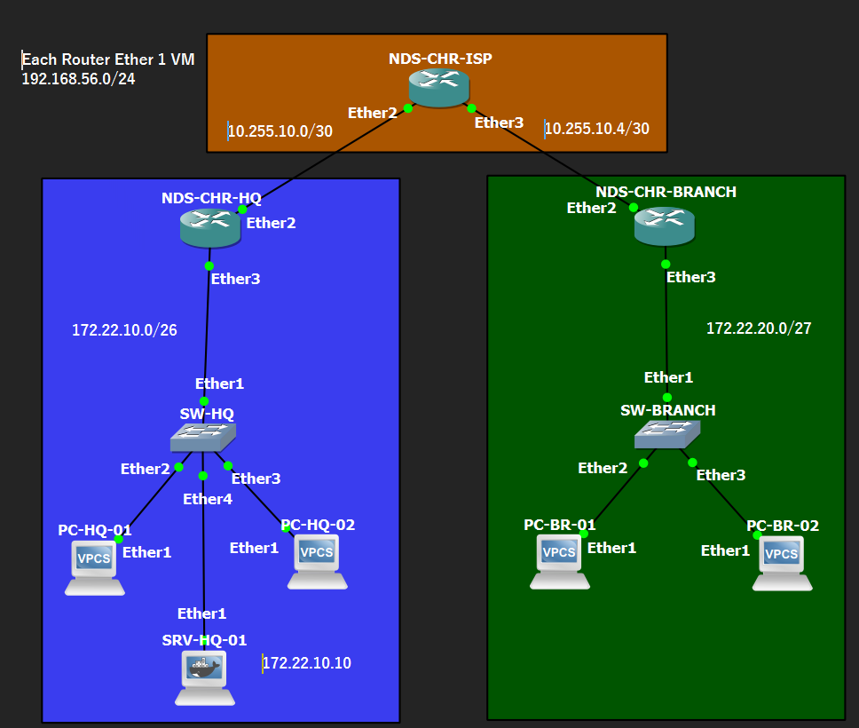
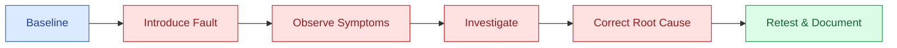

<div align="center">

# 🛠️ Network Troubleshooting

### NDS-NET-001 · Small Office Multi-Site Network Deployment


**A collection of controlled network fault investigations, recovery procedures, and post-recovery verification for the NDS HQ–ISP–Branch topology.**

</div>

---

## 🧭 Overview

This section documents **Phase 06 — Network Validation & Troubleshooting** of the NDS-NET-001 project. Three controlled failure scenarios are investigated against the validated network baseline established in Phases 01–05.

Each case records the observed symptoms, diagnostic evidence, verified root cause, corrective action, and recovery results. The goal is to demonstrate a repeatable troubleshooting workflow without adding permanent devices or changing the approved network architecture.

<table>
<tr>
<td width="50%" valign="top">

### 🎯 Objectives

- Identify failures using RouterOS and GNS3 evidence
- Isolate connectivity, firewall, and routing issues
- Restore normal inter-site operation
- Verify recovery against the known-good baseline

</td>
<td width="50%" valign="top">

### 🧰 Environment

- **Emulation:** GNS3 + VirtualBox
- **Routers:** MikroTik CHR (HQ, ISP, Branch)
- **Clients:** 4 VPCS, 2 per site
- **Service:** Nginx HTTP server at HQ only
- **Management:** WinBox and RouterOS CLI

</td>
</tr>
</table>

## 🗺️ Network Context

<div align="center">



<sub>HQ LAN <code>172.22.10.0/26</code> · ISP private transit · Branch LAN <code>172.22.20.0/27</code></sub>

</div>

## 📂 Troubleshooting Cases

| Case | Fault Category | Investigation Scope | Status |
|:--:|---|---|:--:|
| **01** | [WAN Link Failure](scenario-01-wan-link-failure/) | ISP–HQ interface disabled, inactive HQ route, two-way connectivity recovery (5/5 each direction) | ✅ Completed |
| **02** | [Firewall Policy Failure](scenario-02-firewall-policy-failure/) | Firewall chain, rule order, matching criteria, and packet counters | ⏳ Planned |
| **03** | [Static Route Failure](scenario-03-static-route-failure/) | Route selection, destination prefixes, next-hop reachability, and recovery | ⏳ Planned |

> Case 01 is completed and documented. Cases 02–03 remain planned. Scenarios are conducted individually, with baseline recovery verified before starting the next case.

## 🔎 Investigation Workflow



## ✅ Recovery Acceptance Criteria

<table>
<tr>
<td width="50%" valign="top">

### 🌐 Connectivity

- HQ ↔ Branch ICMP communication restored
- Relevant WAN neighbor connectivity operational
- Static routes and forwarding behavior match the baseline

</td>
<td width="50%" valign="top">

### 🔐 Services & Security

- Branch-to-HQ HTTP access remains available where permitted
- Existing firewall allow/drop policies remain intact
- Router management access remains available through the Host-Only network

</td>
</tr>
</table>

## 📝 Case Reports & Evidence

Each scenario will have its own `README.md` describing the failure, investigation, root cause, fix, and recovery verification. **Screenshots are stored directly alongside that README in the scenario folder**, without an additional `screenshots/` directory.

```text
troubleshooting/
├── README.md
├── scenario-01-wan-link-failure/
│   ├── README.md                 # Case 01 report — completed
│   ├── CASE01-BASELINE.rsc
│   ├── CASE01-FAULT-INJECTION.rsc
│   └── [six evidence images]
├── scenario-02-firewall-policy-failure/
│   ├── README.md                 # Published after Scenario 02
│   └── [evidence images]
└── scenario-03-static-route-failure/
    ├── README.md                 # Published after Scenario 03
    └── [evidence images]
```

**Evidence policy:** Captures show actual observations and test outcomes. Binary RouterOS backups and unreviewed configuration exports are kept private; only appropriately sanitized evidence is published.

---

<div align="center">

<sub>Part of <a href="../README.md">NDS-NET-001 · Small Office Multi-Site Network Deployment</a></sub>

</div>
