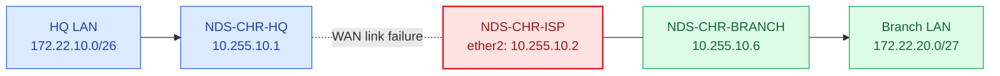
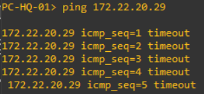
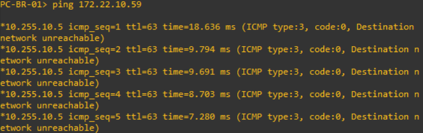
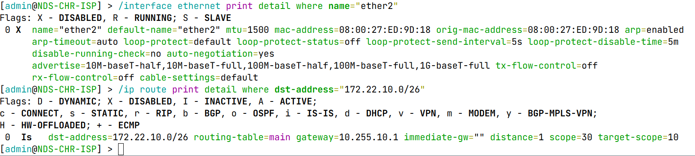
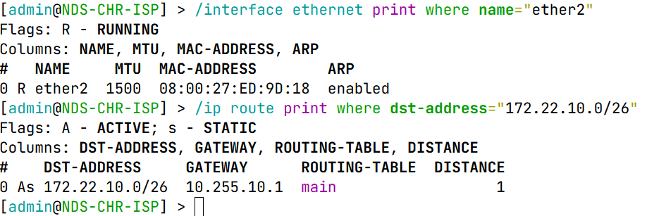
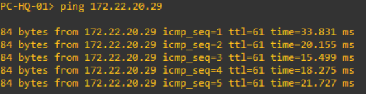
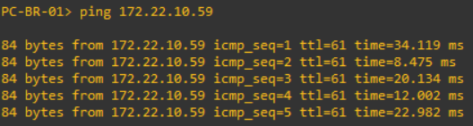

<div align="center">

# 🔌 Case 01 — WAN Link Failure

**NDS-NET-001 · Phase 06 — Network Validation & Troubleshooting**  
**PT Nusa Digital Solusi (NDS) · GNS3 / MikroTik RouterOS 7.23.8**


*A controlled ISP–HQ WAN failure investigated through end-to-end ICMP tests, interface status, and static-route availability.*

</div>

---

## 🧭 Scenario at a Glance

<table>
<tr>
<td width="50%" valign="top">

### 🏢 Network Context

- **Headquarters LAN:** `172.22.10.0/26`
- **Branch LAN:** `172.22.20.0/27`
- **HQ–ISP WAN:** `10.255.10.0/30`
- **ISP–Branch WAN:** `10.255.10.4/30`
- **Affected router:** `NDS-CHR-ISP`
- **Affected interface:** `ether2` (toward HQ)

</td>
<td width="50%" valign="top">

### 🎯 Test Objectives

- Observe inter-site connectivity during a WAN failure
- Identify the failed component from RouterOS evidence
- Explain the effect on static-route availability
- Restore the WAN link without changing the network design
- Confirm bidirectional connectivity after recovery

</td>
</tr>
<tr>
<td width="50%" valign="top">

### 🧰 Environment

- **Emulator:** GNS3 + VirtualBox
- **Routers:** MikroTik CHR (HQ / ISP / Branch)
- **Test clients:** VPCS `PC-HQ-01` and `PC-BR-01`
- **Investigation:** RouterOS CLI, WinBox, VPCS ping

</td>
<td width="50%" valign="top">

### 📍 Scenario Outcome

- **Failure reproduced:** Yes
- **Root cause identified:** ISP `ether2` administratively disabled
- **Recovery performed:** Re-enable ISP `ether2`
- **End-to-end recovery:** 5/5 replies in each direction

</td>
</tr>
</table>

## 🗺️ Affected Network Path



The ISP–Branch link remained available, but the ISP–HQ connection was interrupted. There was no alternate inter-site path.

## 🧪 Baseline & Fault Configuration

Two RouterOS text exports were captured from **NDS-CHR-ISP**:

| File | Description |
|---|---|
| [`CASE01-BASELINE.rsc`](CASE01-BASELINE.rsc) | Configuration export from the working Phase 05 baseline |
| [`CASE01-FAULT-INJECTION.rsc`](CASE01-FAULT-INJECTION.rsc) | Configuration export while the deliberate fault was active |

**Important:** These are configuration snapshots, **not** incremental patch scripts. They should be reviewed and sanitized before publication, and should not be imported into an already configured router without a separate restoration plan. The private binary backup is not part of the public repository.

The controlled fault was introduced on **NDS-CHR-ISP** by disabling `ether2`:

```routeros
/interface ethernet disable [find where name="ether2"]
```

Only the ISP–HQ WAN interface was intentionally changed in this scenario. The management interface `ether1` was not part of the fault.

## 🔎 Investigation Results

### 01 · HQ → Branch connectivity failure

From `PC-HQ-01` (`172.22.10.59/26`):

```text
ping 172.22.20.29
```

**Observed:** Five consecutive ICMP timeouts. No Echo Reply was received.



### 02 · Branch → HQ network unreachable

From `PC-BR-01` (`172.22.20.29/27`):

```text
ping 172.22.10.59
```

**Observed:** Five ICMP *Destination Network Unreachable* messages originating from `10.255.10.5`, the ISP interface facing Branch. Unlike a timeout, this returned an explicit routing error.



### 03 · ISP interface and route inspection

On `NDS-CHR-ISP`:

```routeros
/interface ethernet print detail where name="ether2"
/ip route print detail where dst-address="172.22.10.0/26"
```

| Component | Observed State | Interpretation |
|---|---|---|
| ISP `ether2` | `X` — Disabled | WAN interface administratively disabled |
| Route to `172.22.10.0/26` | `Is` — Inactive Static | Configured static route not available for forwarding |
| Route next hop | `10.255.10.1` | HQ WAN gateway |
| Route `immediate-gw` | Empty | Next hop could not be resolved |



### 🔍 Verified Root Cause

**The ISP router's `ether2` interface had been administratively disabled.** This removed the operational ISP–HQ WAN path, preventing the ISP from resolving the next hop `10.255.10.1`. Consequently, the static route to the HQ LAN became inactive, and bidirectional end-to-end connectivity failed.

The static route configuration itself had not been removed or assigned an incorrect gateway.

## 🛠️ Corrective Action

On `NDS-CHR-ISP`, the disabled WAN interface was enabled:

```routeros
/interface ethernet enable [find where name="ether2"]
```

The following read-only commands confirmed that the interface and affected route returned to operational status:

```routeros
/interface ethernet print where name="ether2"
/ip route print where dst-address="172.22.10.0/26"
```

| Component | Before | After |
|---|---|---|
| ISP `ether2` | `X` — Disabled | `R` — Running |
| Static route to HQ | `Is` — Inactive Static | `As` — Active Static |



## ✅ Post-Recovery Validation

<table>
<tr>
<td width="50%" valign="top">

### 🔵 HQ → Branch

**Source:** `PC-HQ-01`  
**Destination:** `172.22.20.29`

**Result: 5/5 replies — PASS**



</td>
<td width="50%" valign="top">

### 🟢 Branch → HQ

**Source:** `PC-BR-01`  
**Destination:** `172.22.10.59`

**Result: 5/5 replies — PASS**



</td>
</tr>
</table>

| Acceptance Check | Observed Result | Status |
|---|---|:--:|
| ISP–HQ WAN interface operational | ISP `ether2` flag `R` | ✅ PASS |
| Route to HQ LAN active | `172.22.10.0/26` flag `As` | ✅ PASS |
| HQ → Branch ICMP | 5/5 replies | ✅ PASS |
| Branch → HQ ICMP | 5/5 replies | ✅ PASS |

> **Validation boundary:** This case verified WAN interface recovery, the affected route, and two-way PC-to-PC ICMP connectivity. A separate post-recovery HTTP service test was not part of the evidence collected for this scenario.

## 📁 Evidence Index

| File | Evidence |
|---|---|
| `01-ping-hq-to-branch-failed.png` | HQ-to-Branch timeouts during fault |
| `02-ping-branch-to-hq-failed.png` | ICMP network-unreachable response from ISP |
| `03-isp-interface-and-route-investigation.png` | Disabled interface and inactive static route |
| `04-isp-interface-and-route-recovered.png` | Running interface and active static route |
| `05-ping-hq-to-branch-recovered.png` | HQ-to-Branch ICMP recovery |
| `06-ping-branch-to-hq-recovered.png` | Branch-to-HQ ICMP recovery |

## 🏁 Conclusion

**Case 01 — WAN Link Failure: Completed.** A deliberately disabled ISP WAN interface caused an inactive route toward the HQ LAN and interrupted connectivity in both directions. Restoring the interface returned the static route to the active state, and all ten post-recovery ICMP probes succeeded.

---

[← Troubleshooting Overview](../README.md) · [↑ Project Overview](../../README.md)
