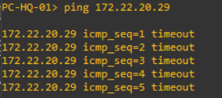
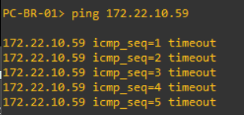
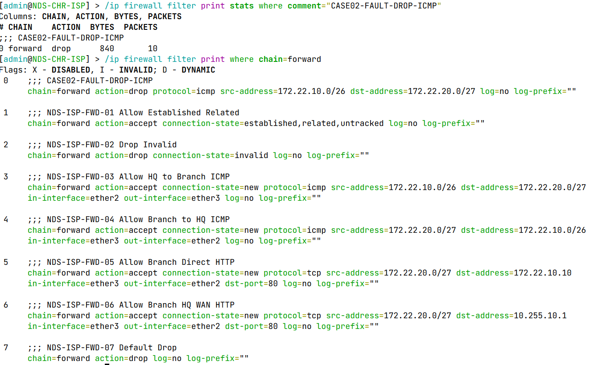
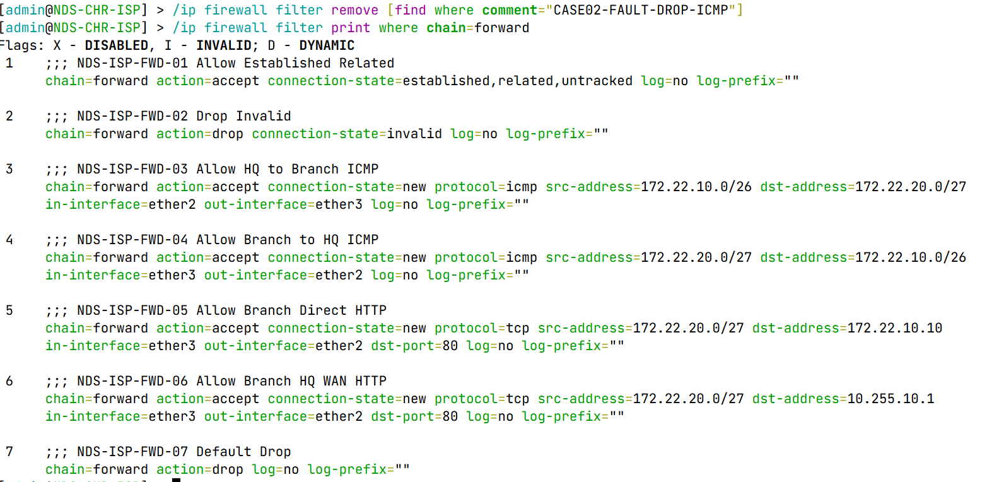
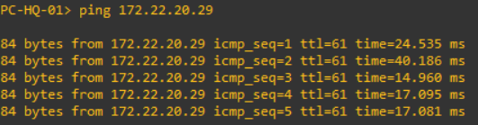
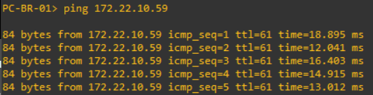

<div align="center">

# 🛡️ Case 02 — Firewall Policy Failure

**NDS-NET-001 · Network Validation & Troubleshooting**  
PT Nusa Digital Solusi · MikroTik RouterOS 7.23.8 · GNS3


*A controlled firewall-policy fault in the simulated ISP router, investigated through connectivity tests, rule-order analysis, and packet counters.*

</div>

---

## 🧭 Case at a Glance

<table>
<tr>
<td width="50%" valign="top">

### 🎯 Objective

Investigate an inter-site ICMP connectivity failure caused by a deliberately inserted firewall rule, identify the root cause, and restore the approved baseline policy.

</td>
<td width="50%" valign="top">

### 🖥️ Environment

- **Platform:** GNS3, VirtualBox, MikroTik CHR
- **Router:** `NDS-CHR-ISP`
- **Affected chain:** `forward`
- **Clients:** `PC-HQ-01`, `PC-BR-01`

</td>
</tr>
<tr>
<td width="50%" valign="top">

### 🌐 Network Context

- **HQ LAN:** `172.22.10.0/26`
- **Branch LAN:** `172.22.20.0/27`
- **HQ test client:** `172.22.10.59`
- **Branch test client:** `172.22.20.29`

</td>
<td width="50%" valign="top">

### ✅ Outcome

- Misordered ICMP DROP rule identified
- **10 packets / 840 bytes** matched the fault rule
- Original seven ISP FORWARD rules restored
- Bidirectional ICMP restored: **5/5 each direction**

</td>
</tr>
</table>

## 📁 Configuration Snapshots

| File | Purpose |
|---|---|
| [`CASE02-BASELINE.rsc`](CASE02-BASELINE.rsc) | ISP RouterOS export before fault injection |
| [`CASE02-FAULT-INJECTION.rsc`](CASE02-FAULT-INJECTION.rsc) | ISP RouterOS export with the fault rule present |

> These `.rsc` files are **configuration exports**, not incremental patch scripts. Do not import them into an existing router to toggle the scenario. Review and sanitize exports before publishing; keep binary backups private.

## ⚠️ Fault Injection

The following rule was added on `NDS-CHR-ISP` above the existing FORWARD accept rules:

```routeros
chain=forward action=drop protocol=icmp \
    src-address=172.22.10.0/26 \
    dst-address=172.22.20.0/27 \
    comment="CASE02-FAULT-DROP-ICMP"
```

The rule was observed at position **0**, preceding:

- `NDS-ISP-FWD-01` — Accept Established/Related/Untracked
- `NDS-ISP-FWD-03` — Allow HQ → Branch ICMP
- `NDS-ISP-FWD-04` — Allow Branch → HQ ICMP

This deliberately overrides the normal allow policy for matching traffic. Unlike a general firewall outage, the injected rule targets **ICMP packets with source HQ LAN and destination Branch LAN**, rather than all protocols or all traffic.

## 🔍 Investigation & Evidence

<table>
<tr>
<td width="50%" valign="top">

### 01 · HQ → Branch failure



`PC-HQ-01` ping to `172.22.20.29`: **5/5 timeout**.

</td>
<td width="50%" valign="top">

### 02 · Branch → HQ failure



`PC-BR-01` ping to `172.22.10.59`: **5/5 timeout**.

</td>
</tr>
<tr>
<td width="50%" valign="top">

### 03 · ISP firewall investigation



Fault rule: **10 packets / 840 bytes**. The DROP rule appears before the established/related and ICMP accept rules.

</td>
<td width="50%" valign="top">

### 04 · Firewall recovery



The injected rule was removed. All seven original ISP FORWARD rules remained in their original order.

</td>
</tr>
<tr>
<td width="50%" valign="top">

### 05 · HQ → Branch restored



`PC-HQ-01` → `172.22.20.29`: **5/5 replies**.

</td>
<td width="50%" valign="top">

### 06 · Branch → HQ restored



`PC-BR-01` → `172.22.10.59`: **5/5 replies**.

</td>
</tr>
</table>

## 🧩 Root Cause Analysis

**Root cause:** An incorrectly prioritized firewall rule, `CASE02-FAULT-DROP-ICMP`, matched ICMP traffic from the HQ LAN to the Branch LAN and discarded it before the intended accept rules could process it.

For **HQ → Branch**, the ICMP Echo Request matched the injected DROP rule. For **Branch → HQ**, the request could proceed in the reverse direction, but its Echo Reply traveled from HQ toward Branch and could match the same higher-priority DROP rule. Because the DROP was above `accept established,related`, tracked reply traffic did not receive the usual early acceptance. The observed bidirectional timeouts and packet counter supported this diagnosis.

## 🔧 Corrective Action

The incident-specific rule was removed from `NDS-CHR-ISP`:

```routeros
/ip firewall filter remove [find where comment="CASE02-FAULT-DROP-ICMP"]
```

The existing baseline rules were preserved rather than reordered or recreated.

## ✅ Recovery Validation

| Check | During Fault | After Recovery |
|---|---|---|
| HQ → Branch (`172.22.10.59` → `172.22.20.29`) | 5 timeouts | 5 replies |
| Branch → HQ (`172.22.20.29` → `172.22.10.59`) | 5 timeouts | 5 replies |
| ISP FORWARD policy | Fault DROP at position 0 | Seven baseline rules restored |

**Result: PASS.** Bidirectional ICMP connectivity was restored with no observed packet loss in the five-packet tests. The fault was isolated to firewall policy; no addressing, static routes, or physical links were changed for this case.

## 📌 Key Findings

- Firewall rules are processed in order; an early DROP can override a later, more specific ACCEPT.
- A direction-specific ICMP rule can affect ping initiated in either direction because Echo Request and Echo Reply travel in opposite directions.
- Filter counters and rule ordering together provide stronger evidence than ping timeouts alone.
- Removing the injected rule restored the original policy without altering production-style baseline rules.

---

[← Troubleshooting index](../README.md) · [← Main project](../../README.md)
