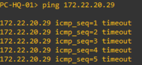
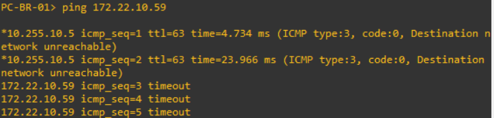
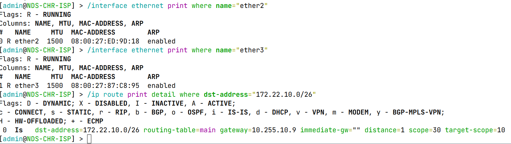
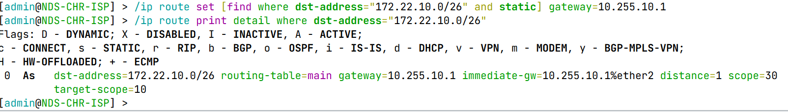
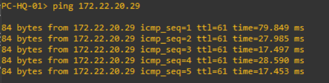
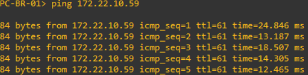

<div align="center">

# 🧭 CASE 03 — Static Route Failure

### NDS-NET-001 · Phase 06 — Network Validation & Troubleshooting


**A controlled next-hop misconfiguration on the simulated ISP router, followed by routing diagnosis and verified bidirectional connectivity recovery.**

[← Troubleshooting Index](../README.md)

</div>

---

## 🧭 Case at a Glance

<table>
<tr><td width="50%" valign="top">

### 🎯 Scenario

- **Router:** `NDS-CHR-ISP`
- **Affected route:** `172.22.10.0/26`
- **Normal next-hop:** `10.255.10.1`
- **Injected next-hop:** `10.255.10.9`
- **Fault type:** Incorrect static route gateway

</td><td width="50%" valign="top">

### 🧰 Test Environment

- **Emulation:** GNS3 + VirtualBox
- **Operating system:** MikroTik RouterOS 7.23.8
- **Clients:** `PC-HQ-01`, `PC-BR-01` (VPCS)
- **Test traffic:** Bidirectional ICMP
- **Tools:** RouterOS CLI and VPCS terminal

</td></tr>
</table>

## 📂 Configuration Snapshots

| File | Purpose |
|---|---|
| [`CASE03-BASELINE.rsc`](CASE03-BASELINE.rsc) | RouterOS configuration exported before the fault |
| [`CASE03-FAULT-INJECTION.rsc`](CASE03-FAULT-INJECTION.rsc) | RouterOS configuration exported with the incorrect next-hop |

> These `.rsc` files are configuration snapshots, not incremental patch scripts. Review and sanitize exports before publishing. Do not import a full export into an existing running configuration without a separate restoration plan. Binary backups should remain private.

## ⚠️ Fault Injection

The ISP router originally routed the HQ LAN `172.22.10.0/26` via `10.255.10.1` on the HQ-facing WAN segment. For this scenario, the route's gateway was deliberately changed to `10.255.10.9`.

```routeros
/ip route set [find where dst-address="172.22.10.0/26" and static] gateway=10.255.10.9
```

The route remained configured but became **`Is` (Inactive Static)**, with `immediate-gw=""`. Both ISP WAN interfaces, `ether2` and `ether3`, remained **Running**. Unlike a link outage, this failure was caused by next-hop resolution rather than a disabled interface.

## 🔍 Symptoms & Investigation

<table>
<tr><td width="50%" valign="top">

### 01 · HQ → Branch



`PC-HQ-01` (`172.22.10.59`) → `PC-BR-01` (`172.22.20.29`): **5 ICMP timeouts**.

</td><td width="50%" valign="top">

### 02 · Branch → HQ



`PC-BR-01` → `PC-HQ-01`: **2 ICMP Destination Network Unreachable responses from `10.255.10.5`, followed by 3 timeouts**.

</td></tr>
</table>

### 03 · ISP Interface and Route Inspection



The CLI investigation showed:

| Check | Observed state |
|---|---|
| ISP `ether2` | `R` — Running |
| ISP `ether3` | `R` — Running |
| Route `172.22.10.0/26` | `Is` — Inactive Static |
| Configured gateway | `10.255.10.9` |
| Resolved immediate gateway | Empty |

**Verified root cause:** The ISP router could not resolve the incorrectly configured next-hop for the HQ LAN route. The route therefore was not eligible for forwarding, even though the WAN interfaces were operational.

### Why were both directions affected?

The Branch-to-HQ request reached the ISP, which lacked an active path to the HQ LAN. In the reverse test, an HQ-to-Branch request could traverse the available routing path, but its return traffic required the ISP's now-inactive route to the HQ LAN. End-to-end ICMP therefore failed in both test directions.

## 🛠️ Corrective Action

The existing static route was restored to the approved gateway. No other route, interface, or firewall rule was changed for the fix.

```routeros
/ip route set [find where dst-address="172.22.10.0/26" and static] gateway=10.255.10.1
```

### 04 · Routing Recovery



After recovery, the route displayed **`As` (Active Static)**, `gateway=10.255.10.1`, and `immediate-gw=10.255.10.1%ether2`.

## ✅ End-to-End Recovery Validation

<table>
<tr><td width="50%" valign="top">

### 05 · HQ → Branch Recovered



**5/5 ICMP replies** — `172.22.10.59` → `172.22.20.29`.

</td><td width="50%" valign="top">

### 06 · Branch → HQ Recovered



**5/5 ICMP replies** — `172.22.20.29` → `172.22.10.59`.

</td></tr>
</table>

| Acceptance criterion | Result |
|---|---|
| ISP WAN interfaces remain Running | ✅ Pass |
| ISP-to-HQ static route is Active | ✅ Pass |
| HQ → Branch ICMP | ✅ 5/5 |
| Branch → HQ ICMP | ✅ 5/5 |
| Total recovery ICMP packet loss | ✅ 0% |

## 💡 Key Findings

- An existing static route is not necessarily an **active** forwarding path.
- A wrong next-hop may make a route inactive even when its interfaces are healthy.
- ICMP failure in both directions can result from an unavailable **return route**, not necessarily a failure on both outbound paths.
- Diagnosis should distinguish interface state, route state, gateway resolution, and end-to-end reachability.

---

<div align="center"><sub>CASE 03 — Completed · Part of <a href="../README.md">NDS-NET-001 Network Troubleshooting</a></sub></div>
